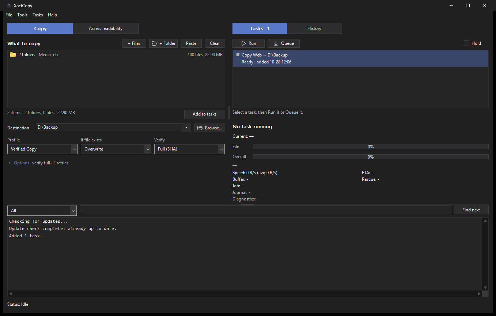
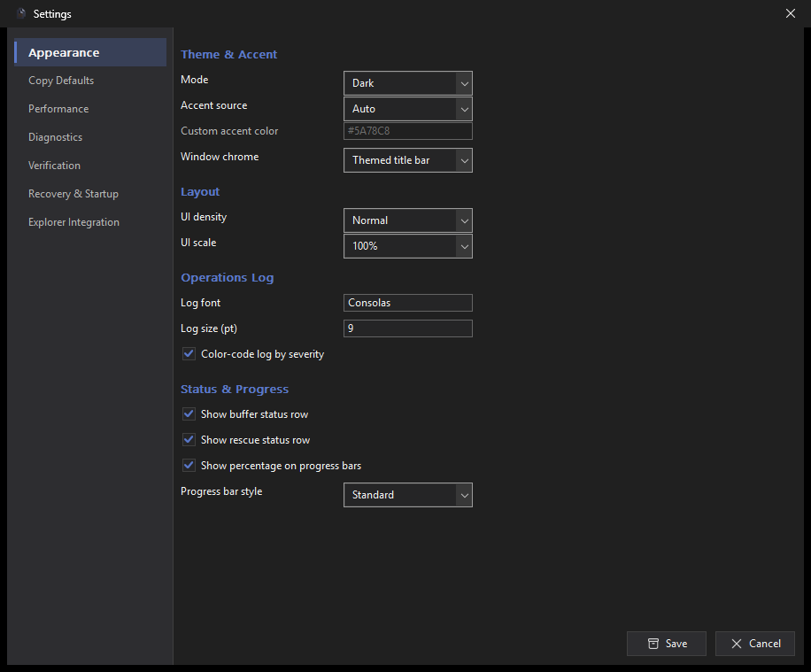
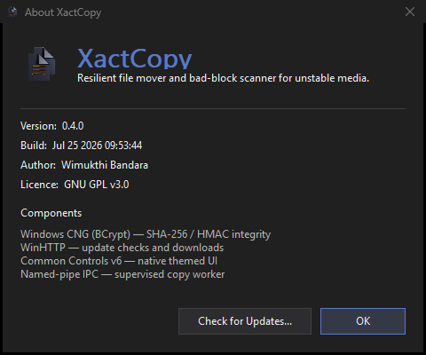
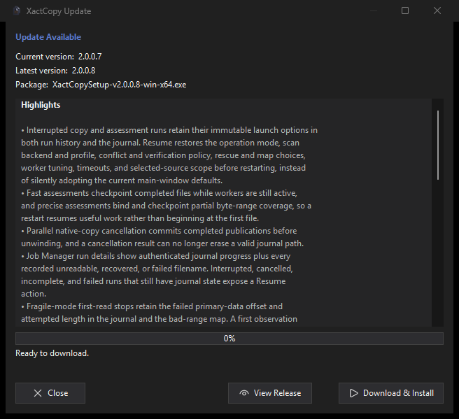

# XactCopy User Guide

Everything XactCopy does, option by option. If you only want to get going, the
Quick Start in the [README](../README.md) is enough.

## Contents

- [The main window](#the-main-window)
- [Copy mode](#copy-mode)
- [Assess Readable Files mode](#assess-readable-files-mode)
- [Resilience options](#resilience-options)
- [Verification](#verification)
- [Bad-range maps](#bad-range-maps)
- [Crash recovery](#crash-recovery)
- [Explorer integration](#explorer-integration)
- [Settings](#settings)
- [Updates](#updates)
- [Menu reference](#menu-reference)
- [Command line](#command-line)
- [Where XactCopy stores its data](#where-xactcopy-stores-its-data)

## The main window



The window has two columns above the operations log. On the left is the task
list; on the right are the selected task's settings and, at the bottom, the
**Now running** card.

Two splitters set the proportions: drag the bar above the log to trade log
height for list height, or the line between the columns to widen one side.
XactCopy remembers both, keeps the log height when the window is resized, and a
double-click on a splitter returns it to the automatic split.

### Adding a task

Every add makes a task: **+ Files**, **+ Folder**, **Paste** (files copied in
Explorer, or paths copied as text, one per line), dropping files on the window,
or the Explorer context menu. The **Action** box in front of the add buttons
says what the new task does, **Copy** or **Assess readability**, so the toolbar
reads left to right: choose the action, then add. Everything one action brings in is one task:
three folders picked in one **+ Folder** dialog make one task that copies all
three. The new task takes the **New task settings** and is selected, so its
settings are on the right if you want to change anything before running it.

The New task settings are what the right column shows when no task is selected
(click below the last task, or press <kbd>Esc</kbd> in the list). Set the
choices and options there once and every add uses them; their Action is the
toolbar's. In Copy mode a new
task copies to the New task **Destination**; leave it empty and each add asks
where the items go (cancelling adds nothing).

Every item is copied *as itself*: a folder `Photos` lands as
`Destination\Photos`, exactly as Explorer would place it. For a task of one
folder, **Copy the folder's contents, not the folder** under its Source copies
only what is inside it. Items do not need to share a folder: a task whose items
come from several folders or drives runs them as parts, back to back, and
XactCopy warns when it is made if two of them would write the same name into
the destination.

### A task's settings

Selecting a task shows its settings on the right, and every change is saved to
the task as you make it. Its **Action** picks what it does: Copy writes the
items to a destination and verifies them; Assess readability only reads them
and records unreadable ranges, so the destination row gives way to a note and
the choices relabel themselves for scanning. Switching a task to Copy asks for
a destination if it has none. A task's Action is its own: the toolbar's Action
stays what the next add does.

**Source** lists the task's items; type new paths (separate several with
semicolons) or use its *Browse…* to pick other folders or files. The line under
it shows what the task holds and its size, counted in the background, and warns
when the destination may not have room. **Destination** changes by typing, with
*Browse…*, or from the recent list on the **▾** button. Typed paths apply when
you leave the box; neither box can be left empty, and a source path that does
not exist is refused, putting the box back as it was.

Below them are captioned choices. Copy mode shows **Profile**,
**If file exists**, **Verify**, and **Read method**; assessment mode shows **Scan**
(Auto/Fast/Precise), **Read method** (standard file reads or direct NTFS), and
**Findings** (whether the bad-range map is updated). The resilience toggles
and numeric tuning fields follow below them. The running task's settings are
shown but cannot change until it ends.

**File → Save as defaults** saves the settings shown (engine, overwrite,
verification, resilience, buffer, retry, and timeout) as the defaults the New
task settings start from.

### Tasks and History

The left column switches between two views.

**Tasks** lists the running task first, then the queued tasks in the order they
will run, then everything else. Each row shows its state (ready, queued with its
position, running with a thin progress bar, or how its last run ended) and, for
a task with several parts, which part is running. The two buttons above the
list act on the selected task:

| Selected task | Buttons |
| --- | --- |
| Not queued | **Run** (now, or next if another task is running) · **Queue** (add to the end) |
| Queued | **Start now** (run it next) · **Unqueue** |
| Running | **Pause** / **Resume** · **Stop** (it can resume from its journal later; a multi-part task stops entirely, and the queue holds) |

Tasks run one at a time. Tick **Hold** to let the current task finish and then
wait; Run and Start now still start the task you picked, and the hold keeps
covering the rest. Stop also holds the queue, and so does a task that fails to
start: it goes back to the front (a later part of a multi-part task waits to
run from that part) until you untick Hold. While XactCopy waits for
administrator approval for direct NTFS reads, Stop withdraws the request.
**Remove** (or <kbd>Del</kbd>) removes the selected task; its run history
stays. Reorder queued tasks with the right-click menu or
<kbd>Ctrl</kbd>+<kbd>↑</kbd>/<kbd>↓</kbd>. The right-click menu also pins,
renames, duplicates, and opens the destination.
<kbd>Enter</kbd> does what the first button does, and <kbd>Ctrl</kbd>+<kbd>Enter</kbd>
queues the selected task.

**History** lists every run, newest first, including interrupted ones.
Selecting a run shows its details on the right, with its authenticated
checkpoint: completed and pending counts and every unreadable, recovered, or
failed file. The toolbar has **Resume** (for an interrupted, cancelled,
incomplete, or failed run, or one that finished with skipped, failed, or
recovered files), **Journal** (a readable JSON view), **Report...** (CSV),
**Range map**, and **Delete**, as many as the column has room for; the
right-click menu has them all. The run in progress cannot be deleted, and
**Clear history** waits until it has finished.

A journal is named after its source and destination, so every run of the same
task shares one journal, which holds the latest of them. On an older run,
Resume, Journal, Report, and Range map say so instead of showing the later
run's data. Journal retention (Settings, **Delete journals after**) deletes
journals of runs older than the set number of days; their rows stay in History
without those actions.

**Range map** draws, for each file in the run's journal, which byte ranges were
read, recovered, unreadable, or skipped as known-bad; hover the bar for offsets
and lengths. Files with unreadable or recovered bytes are listed first. It shows
this one run; the source's durable bad-range map, built up across runs, is under
**Tools → Inspect Bad-Range Map**. Fast and direct-NTFS assessments record
ranges only for files with unreadable areas, so a clean assessment has no map.

**Pinned tasks** always stay. Other tasks start unpinned, and when XactCopy
closes it asks whether to keep them, with a **Remember my choice** box.
**Settings → Recovery & Startup → Unpinned tasks on exit** (Ask / Keep /
Discard) changes that later; pin a task from its right-click menu. Tasks, the
queue, and history live in XactCopy's signed job catalog, so they survive a
crash or power loss either way.

After a restart the queue is held, so nothing starts on its own, unless
**Settings → Recovery & Startup → Run the queue automatically on startup** is
on. That automatic run requires bound source/destination media identities, full
verification, Continue on error off, and both recovered-overwrite/plaintext
expert overrides off. It also skips tasks that wait for media or for file locks,
retry more than three times, follow symbolic links, run the worker at High
priority, or (assessments) use direct NTFS reads or more than eight scan
workers. Tasks outside that policy are skipped, stay queued, and say why.

### Now running

The card at the bottom of the right column follows the running task whatever
is selected. It is headed with the task's name and has **Pause** / **Resume**
and **Stop**; below are the current file, the **File** and **Overall** progress
bars, counters, throughput with a running average, an **ETA**, the buffer and
rescue telemetry, the job summary, and the run's **Journal** path. The bars and
figures are always there: when a run ends the heading says how it ended and
its figures stay until the next one. The first Stop requests cooperative
shutdown; a second force-stops a worker that is stuck inside a Windows or
device I/O call.

### Tasks files

**File → Export Tasks…** saves every task to a tasks file (`.xctasks`), and
**File → Import Tasks…** (or dropping a `.xctasks` file on the window) adds the
tasks a file lists. Imported tasks are not queued, so you can check their
settings before running them. A tasks file is readable JSON and can be
written by hand:

```json
{
  "Format": "XactCopy.Tasks",
  "Version": 1,
  "Tasks": [
    {
      "Name": "Photos to backup",
      "Action": "Copy",
      "Sources": ["D:\\Photos", { "Path": "E:\\Camera", "ContentsOnly": true }],
      "Destination": "F:\\Backup",
      "Pinned": true,
      "Options": { "VerificationMode": "Full", "MaxRetries": 2 }
    },
    { "Action": "Assess", "Sources": ["D:\\"] }
  ]
}
```

- **Action**: `Copy` (the default) or `Assess`.
- **Sources**: full paths, at least one. A source written as
  `{ "Path": …, "ContentsOnly": true }` copies what is in the folder rather
  than the folder; a drive root always copies its contents.
- **Destination**: required for `Copy`.
- **Name** and **Pinned**: optional; a name is made from the items when there
  is none.
- **Options**: optional. Any task option, by the name an exported file uses;
  everything left out comes from your saved defaults. Paths, media identities,
  and the journal folder are never taken from Options.

A task that cannot be used (no sources, a Copy without a destination, an
unknown Action) is skipped, and the import says which and why.

When you close XactCopy with a task running, or with unpinned tasks, one prompt
covers both: it says whether a copy or an assessment would stop and asks what
to do with the unpinned tasks.

The operations log can be filtered by severity, searched (Ctrl+F, F3), copied,
and saved; it scrolls horizontally for long paths.

## Copy mode

Copies everything under **Source** into **Destination**, resiliently.

**Profile** applies a coherent starting policy:

| Profile | Behaviour |
| --- | --- |
| **Verified Copy** | Healthy media and an exact result: full verification, 2 retries, 4 MB buffer, and no salvage, continue-on-error, fragile pacing, map recording, or direct reads. The plaintext and recovered-overwrite overrides from Settings are not used. |
| **Recover Media** | Failing media: salvage and keep going, fragile pacing, adaptive 1 MB reads, wait for the drive, record bad ranges, and **direct NTFS reads**, which go to the raw volume and are abandoned at the timeout instead of stalling inside the filesystem (XactCopy restarts elevated for them). Output that is not exact gets a `.recovery.json` sidecar. |
| **Custom** | The main-window options as they are. XactCopy starts in Custom with your saved defaults, and its engine is **Settings → Transfer engine**. Editing an option of Verified Copy or Recover Media switches to Custom but keeps that profile's engine. |

**Overwrite** controls what happens when a destination file already exists:

| Choice | Behaviour |
| --- | --- |
| **Overwrite** | Always replace the destination file |
| **Skip existing** | Never touch an existing destination file |
| **Overwrite if newer** | Replace only when the source is newer |
| **Stop on conflict** | Leave the existing file untouched and report the run as incomplete. |

## Assess Readable Files mode

Reads allocated files beneath **Source** without writing a destination and
records unreadable file-relative ranges. It does not inspect free space or
unallocated sectors and is not a whole-disk health verdict. No destination is
required.

On actively deteriorating hardware, recover the highest-value data first. An
assessment performs an additional pass over the source and may spend limited
device life without copying any bytes. Assess first only when the medium is
stable enough and the map will be reused across later recovery passes.

Scanning runs in a precise profile or a faster parallel one (the **Scan**
choice); the fast profile falls back to precise reads around any fault it finds,
so the resulting map stays accurate, and does its own fallback instead of
using **Retries**. **Fragile-media mode** always scans precisely, so turning it
on locks **Scan** on *Precise*.

The three assessment choices are **Scan** (Auto/Fast/Precise), **Read method**
(standard file reads or direct NTFS allocated-extent reads), and **Findings**
(whether this run updates the bad-range map). Direct NTFS reads require
administrator access; XactCopy asks to restart elevated when a task needs them,
and falls back visibly to standard file reads rather than claiming a raw scan
it did not do. On unstable media, direct reads together with Fragile-media mode
keep a scan moving: a read that hangs is abandoned at the timeout.

Copies can read the same way: copy mode has the same **Read method** choice
(set to direct NTFS by the Recover Media profile). A copy needs the exact bytes, so a file is read
directly only when its whole length is backed by written data; compressed,
encrypted, very small (stored inside the file table), and pre-allocated files
are read through Windows, and the log names each one once.

## Resilience options

These toggles shape how XactCopy handles trouble.

| Option | What it does |
| --- | --- |
| **Salvage unreadable blocks** | When a region can't be read cleanly, preserve readable ranges and fill isolated unreadable ranges deterministically. The run is **Incomplete**, not successful. Non-exact output preserves the original extension and receives an adjacent `.recovery.json` manifest unless the expert overwrite override is enabled. |
| **Resume from journal** | Continue an interrupted job from its journal instead of restarting. On by default; every job is journaled either way. |
| **Record bad ranges** *(copy)* | Add the bad ranges this copy finds to the source's map. Assessments set this with **Findings**. See [Bad-range maps](#bad-range-maps). |
| **Skip known-bad ranges** | Don't re-read ranges that have the same file/media identity and were observed bad in at least two matching runs. This makes a later pass faster without trusting a one-off error. |
| **Adaptive buffer** | Size the read buffer dynamically from measured throughput and latency, backing off on slow or high-latency media. |
| **Continue on error** | Keep going past a file that ultimately can't be copied. Earlier files may already have been atomically published, so the destination can contain a mixed, incomplete generation; the run cannot be a clean success. |
| **Wait for media** | If the source or destination disappears — a drive spins down, a disc is ejected — pause and wait for it to come back rather than failing. |
| **Fragile-media mode** | Minimise stress on a dying drive: gentler retry timing and access patterns, trading speed for a better chance of getting the data off before the drive fails completely. |

**Buffer (MB)**, **Retries**, and **Timeout (s)** set the read buffer size, the
number of XactCopy-level retries, and how long an operation may stall before it
counts as failed. Windows, the filesystem, and the storage device may already
perform lower-level retries before an API call returns an error; XactCopy's
retry count is additional work. The safe default is 2 and the enforced maximum
is 32. Keep the count low on mechanically failing or heat-sensitive media.

### Rescue passes

When the engine hits damage it runs a sequence of *rescue passes* over the
affected regions: fast sweeps first, then progressively more aggressive
strategies — forward and reverse trim sweeps, fine-grained scraping, and targeted
retries of the worst spots — splitting failing ranges and adapting to the density
of errors. The rescue telemetry line reports the current pass, how many regions
remain, and the bytes still outstanding.

## Verification

**Verify** checks that what landed at the destination matches the source:

| Mode | Behaviour |
| --- | --- |
| **None** | No post-copy content check. This is an attended-only choice because a successful Windows copy call is not proof against every source, cable, RAM, or destination corruption mode. |
| **Sampled** | Hash representative ranges. Faster, but corruption outside the samples can be missed; this is also attended-only. |
| **Full** | Hash the complete default data stream and copied alternate data streams. This is the integrity-first default and is required for unattended copy/resume. |

The hash algorithm (SHA-256 or SHA-512) and the sampling chunk size and count are
set under **Settings → Copy Defaults → Verification**. Verification runs after the data is
written, and any mismatch is reported in the log and the job summary.

## Publication and filesystem fidelity

Each destination file is built beside its final path, verified and flushed,
then published with a same-volume atomic rename. A failed read, write, flush, or
verification therefore leaves an existing destination file intact. This is a
**per-file** transaction, not a transaction for the whole folder: if a later
file fails, earlier verified files remain committed. Continue on error makes
that mixed-generation outcome more likely and always produces an incomplete
run when any source item is lost.

XactCopy preserves file timestamps, basic attributes, DACLs, alternate data
streams, and (when enabled) child-directory timestamps/basic attributes/DACLs.
Owner/group and SACL preservation can require privileges and is reported when
incomplete. EFS encryption is preserved or the file fails unless plaintext was
explicitly allowed. NTFS hard-linked names currently become independent exact
files, and directory alternate streams are not copied; both limitations are
reported. Managed Rescue also reports filesystem features such as sparse or
compressed layout that it cannot reproduce exactly.


### Confirming integrity risks

Some option combinations produce a result that cannot be claimed as an exact
copy. When a copy starts with any of them, XactCopy lists them and asks you to
confirm before the run begins:

- Verification is **None**, so destination bytes are never checked.
- Verification is **Sampled**, which can miss corruption outside the samples.
- **Continue on error** is on, which can leave a mixed, incomplete destination.
- Salvage is combined with the expert override that lets synthetic bytes replace
  an existing destination file.
- The expert override that allows EFS-encrypted source data to be published as
  plaintext is on.

The prompt is why these are described as *attended-only*: they are available,
but not something a job should reach unattended without you having seen the
consequence. The **Verified Copy** profile clears all of them.

## Bad-range maps

A **bad-range map** records which byte ranges of a particular source file are
unreadable. Build one with **Assess Readable Files**, or let a copy populate it as it
goes. On later runs, enable **Skip known-bad ranges** so
XactCopy spends its effort on recoverable data instead of grinding on sectors it
already knows are dead.

When **Fragile Media Guard → Skip file on first read error** is enabled, XactCopy
intentionally stops before the rescue passes can localize the failure further.
It records the exact read request that failed as a one-observation diagnostic
range in the signed journal and map. That range is not trusted as a skip hint
until a later run observes the same range against the same file and media
identity. Missing files, locks, access denial, and an offline device are kept as
ordinary run failures and are never promoted to physical range evidence.

**Tools → Inspect Bad-Range Map** reports both the durable map and the latest
matching assessment journal for the selected task's source;
**Clear Source Bad-Range Map** names the source before it removes anything. Every filename is written to the main log. The
journal section can therefore show files that failed or were skipped even when
no byte range could safely be localized; those files are not silently presented
as an empty successful scan.

Maps are signed, age-limited, and bound to the source volume plus each file's
identity, size, last-write time, NTFS change time, and fingerprint. A skip hint
is trusted only after the same bad range is observed twice. Synthetic
salvage-filled ranges are not promoted into future skip hints. The main window
chooses whether a task uses, skips, or updates the map (Options and Findings);
**Settings → Copy Defaults** sets how old a map may be before it is ignored.

## Crash recovery

Because every run is journaled, XactCopy can recover from an unclean shutdown. If
a run was active when XactCopy or Windows went down, the next launch detects the
interrupted run and offers to **Resume** it, continuing from the journal. Choose
**Not now** to leave it for later: it stays in **History**, where **Resume**
picks it up whenever you like, and the startup prompt does not return for it.
Tick **Don't ask at startup** to rely on History alone.

Resume restores the task definition captured when the run started, not the
current main-window defaults: copy versus assessment mode, selected files,
direct-NTFS versus standard scanning, scan profile, conflict/verification
policy, rescue and bad-map behavior, buffers, workers, retries, and timeouts.
Older journals created before task definitions were embedded remain readable;
when their exact settings cannot be reconstructed, XactCopy identifies the
run as legacy and requires review rather than silently guessing.

**Settings → Recovery & Startup → Interrupted runs** chooses what happens at
startup (Ask, Resume automatically, or Leave in History) and whether XactCopy
restarts itself at the next logon after an interruption. Auto-resume uses the same strict unattended policy as the queue;
otherwise XactCopy requires a person to review and confirm the run.

## Explorer integration

Enable **Settings → Recovery & Startup → Context Menu** to add XactCopy to the Windows shell:

- **Copy with XactCopy** — on files, folders, drives, and folder backgrounds. A
  selected item becomes a task that copies exactly that item. Multi-select
  makes one task that copies the selected items together from their shared
  source folder. The folder-background command copies the whole folder's
  contents. The task is a copy, and XactCopy asks where it goes unless the New
  task settings have a destination.
- **Assess with XactCopy**: on the same files, folders, drives, and folder
  backgrounds; the task is an assessment, selected and ready to run. Either
  verb also sets the New task settings to its mode.
- **Open with / drag-and-drop** — XactCopy is registered as an application, so
  you can drop files onto it or pick it from *Open with*.
- **Send to → XactCopy**, and a **Run** dialog entry (`XactCopy`).

All shell entries are per-user and are removed cleanly when you turn the option
off. Launching from Explorer while XactCopy is already running hands the
selection to the running window rather than starting a second copy.

## Settings



**Tools → Settings…** opens five pages. Each setting lives in one place: the
choices the main window shows (profile, overwrite, verify, read method, scan,
findings, the Options toggles, buffer, retries, timeout) are saved as defaults
with **File → Save as defaults**, and Settings holds everything
else.

### Appearance

Theme mode (Dark, Light, System, Classic), accent source (Auto, System, Custom)
and a custom accent colour, and window chrome (themed or standard title bar).
Layout covers UI density and 50–250% application scale in addition to each
monitor's Windows DPI. The Operations Log section sets the log font, size, and
severity colouring. Status & Progress toggles the buffer and rescue status rows,
percentage text on progress bars, and distinct thin, standard, or thick progress
bars.

### Copy Defaults

File handling: preserve source timestamps, copy empty directories, wait for
lock release, and whether *Access Denied* counts as contention (never together
with salvage; a task that salvages turns it off).

Policies: symlink handling (skip or follow), and the
deterministic fill pattern used for unrecoverable bytes (zero or `0xFF`). Legacy
jobs that request random fill are rejected because non-deterministic bytes make
recovery boundaries harder to audit.

Expert integrity overrides permit synthetic recovered bytes to replace an
existing destination or permit an EFS-encrypted source to become plaintext.
Both are off by default, require confirmation for a manual run, and are blocked
for unattended execution. Without the first override, recovery output always
uses a visibly named sidecar. Without the second, EFS encryption must be
preserved or the file fails safely.

Bad Range Map: the maximum age of a map before it is ignored. Whether a task
uses, skips, or updates the map is chosen in the main window (Options and
Findings), as is the direct NTFS **Read method**, which reads allocated file
extents from a local NTFS volume with administrator rights, never scans free or
unallocated space, and falls back to standard file reads when raw access is
unavailable.

Verification: SHA-256 or SHA-512, and the sampled-mode chunk size and count.
Whether a task verifies, and how, is the main window's **Verify** choice.

### Performance

Transfer tuning: transfer engine policy, worker process priority, the per-file
timeout, a throughput cap, small-file worker count and threshold, and scan
worker count.
With worker count set to `0` (Auto), seek-based disks use one worker while
non-seek storage uses up to eight based on processor count. Explicit values up
to 64 remain available for measured expert tuning.

Fragile Media Guard: how fragile mode behaves when a task turns it on. Skip a
file on the first read error, persist those skips across a resume, and the
failure window, threshold, and cooldown that trigger the guard.

Contention & Source Mutation — lock-probe interval, and what to do when the
source changes mid-run (fail the file, skip it, or wait for it to reappear).

Rescue Engine Tuning — per-pass chunk sizes (FastScan, TrimSweep, Scrape,
RetryBad), the minimum split size, and per-pass retry counts. `0` means *auto*
for each; leave these alone unless you are tuning for a specific drive.

### Diagnostics

Worker telemetry profile (Normal, Verbose, Debug), progress interval, and a log
rate cap. UI diagnostics strip and its refresh interval, and the maximum number
of lines the log keeps. Journal storage: the **Journal folder** (type it or use
*Browse…*; empty means the default under your profile; the mirror copy always stays there, and runs
started before a change still resume from the old folder), whether backups are
discarded when a run completes, how long journals are kept, and how many are
always retained.

### Recovery & Startup

Tasks: run the queue automatically on startup, and what happens to unpinned
tasks on exit (Ask, Keep, Discard). Interrupted runs: what happens at startup
(Ask, Resume automatically, or Leave in History), auto-start at the next logon
after an interruption, and the heartbeat write interval. Context Menu: a
single switch for the shell entries described in
[Explorer integration](#explorer-integration).

Settings are stored as JSON. Unknown keys are preserved, so a newer and an older
build can share the same file without either losing settings. Existing explicit
values are not silently rewritten during an upgrade. If they reduce integrity
(for example Verify: None or Continue on error), XactCopy shows an attended-run
confirmation and prevents them from being used by automatic queue/recovery.

## Updates

**Help → About XactCopy** shows the exact version and build — the two things any
bug report needs — along with the **Check automatically** switch that decides
whether XactCopy looks for updates on launch.



**Check for Updates…** there, or **Tools → Check for Updates…**, asks GitHub for
the latest release now.



If a newer version exists, XactCopy shows the release notes and the package name.
**Download & Install** downloads the package, verifies it against its published
SHA-256, and applies it in place, after which XactCopy restarts on the new
version. **View Release** opens the release page in your browser instead.

XactCopy will not install a package it cannot check: if no SHA-256 is published
for the release asset, the update is refused rather than applied unverified.
Release feeds and assets must use HTTPS, truncated/oversized downloads are
rejected, and only an exact XactCopy Windows x64 installer or portable package
is eligible. Portable ZIPs are path-validated, version-checked, backed up at the
package-file level, and rolled back if replacement or post-copy validation
fails. Packages larger than 2 GiB, archive path traversal, Windows reserved
device names, trailing-dot/space aliases, and case-insensitive duplicate paths
are rejected. Downloads and extraction use a random private temporary folder
that is removed without traversing reparse points. Portable application also
refuses reparse points beneath the install folder and verifies every installed
package file against the extracted SHA-256 before restarting.

## Menu reference

| Menu | Items |
| --- | --- |
| **File** | New Task from Files… (Ctrl+O) · New Task from Folder… (Ctrl+Shift+O) · New Task from Paste · Import Tasks… · Export Tasks… · Pause / Resume / Stop Operation · Save as defaults · Open Journal Folder · Open Crash Folder · Exit |
| **Tools** | Inspect/Clear Source Bad-Range Map… · Settings… · Check for Updates… |
| **Tasks** | Queue Selected Task (Ctrl+Enter) · Show Tasks / History · Start the Queue · Resume Interrupted Run |
| **Help** | About XactCopy |

## Command line

`XactCopy.exe` accepts the switches the Explorer verbs use. They are documented
here because they are also useful for scripting; there is no separate console
interface.

| Switch | Effect |
| --- | --- |
| `--source <path>` | Set the source folder. |
| `--from-explorer <path> [<path>…]` | Copy exactly these items. Their shared parent becomes the internal copy root. |
| `--from-explorer-folder <path>` | Copy the whole folder (what the folder-background verb uses). |
| `--scan-from-explorer <path> [<path>…]` | Open in Assess mode targeting these items. |
| `--scan-from-explorer-folder <path>` | Assess the whole folder (the folder-background *Assess* verb). |
| `--resume-interrupted` | Show the resume prompt for an interrupted run on launch. Also accepted as `--force-resume-prompt`. |
| `--recovery-autostart` | Marks the launch as the post-interruption auto-start. Set by XactCopy itself; not meant to be typed. |

`--from-explorer`, `--scan-from-explorer`, and `--from-explorer-folder` also
accept the `=` form, e.g. `--from-explorer="D:\Recovery"`.

Only one instance runs at a time. Launching a second one forwards its arguments
to the running window and exits.

`XactCopyExecutive.exe` is the worker process. It takes `--pipe <name>` and is
started by `XactCopy.exe`; running it directly does nothing useful.

## Where XactCopy stores its data

Everything lives under `%LOCALAPPDATA%\XactCopy\`:

| Path | Contents |
| --- | --- |
| `journals\` | Per-run journals and their rotating backups (or the folder set in **Settings → Diagnostics → Journal folder**); snapshots over 64 KB may be compressed XCJZ containers |
| `journals-mirror\` | A second copy of each journal, always kept here so a failing journal drive cannot take both |
| `journal-views\` | Readable JSON views exported on demand by the History view's **Journal** action |
| `badmaps\` | Bad-range maps |
| `jobs\catalog.json` / `jobs-mirror\` | Signed saved jobs, queue, run history, rotations, and mirror |
| `runtime\recovery-state.json` | The active run and clean-shutdown marker |
| `security\` | HMAC keys — legacy-compatible raw journal key; current-user DPAPI-protected map/catalog keys |
| `settings.json` | Application settings |

**File → Open Journal Folder** opens the journal folder and **File → Open Crash Folder**
opens `runtime\`. Journals are HMAC-signed and hash-chained; bad-range maps and
the saved-job catalog use signed envelopes and trusted fallback snapshots. See
[ARCHITECTURE.md](ARCHITECTURE.md) for the formats.
